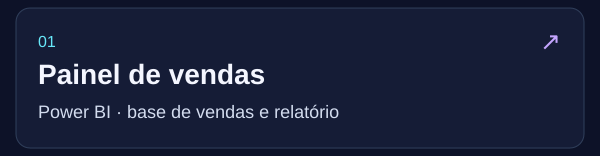
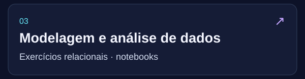
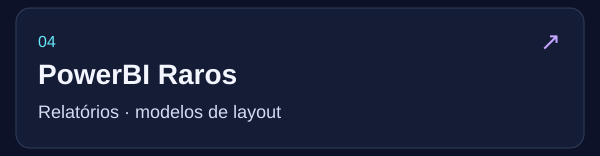

<!-- Imagens na mesma linha HTML, sem BR. Alinhamento middle evita o espaço da linha de base entre as faixas. -->

<b>Minha trajetória em 30 segundos</b>

- **Stefanini / BBTS** · Modelagem, ETL e qualidade de dados.
- **Surf Telecom** · BI comercial, Python, AWS e liderança funcional.
- **Every Cybersecurity** · Dashboards, automatizações e capacitação.
- **MDHC** · Integração de bases, indicadores e orientação técnica.

