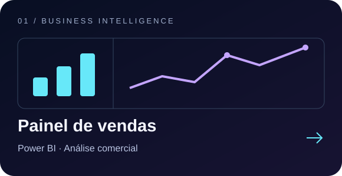
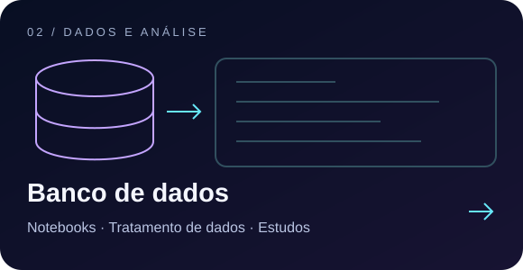

<a href="https://juliadaphny.github.io/Portifolio/"><b>↗ PORTFÓLIO</b></a> &nbsp; · &nbsp;
<a href="https://www.linkedin.com/in/julia-daphny-196402112/"><b>↗ LINKEDIN</b></a>

<b>SQL, Python e Power BI para transformar dados em decisões.</b>

Resultados da trajetória profissional; não representam o escopo dos projetos abaixo.

### Explore meus projetos

<b>Minha trajetória em 30 segundos</b>

- **Stefanini / BBTS** · Modelagem, ETL e qualidade de dados.
- **Surf Telecom** · BI comercial, Python, AWS e liderança funcional.
- **Every Cybersecurity** · Dashboards, automações e capacitação.
- **MDHC** · Integração de bases, indicadores e orientação técnica.

🎓 Pós em Inteligência Artificial nos Negócios · conclusão em **2028**.

<a href="https://www.linkedin.com/in/julia-daphny-196402112/"><b>Vamos conversar ↗</b></a>

